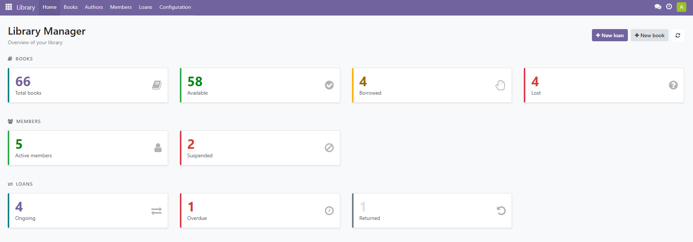
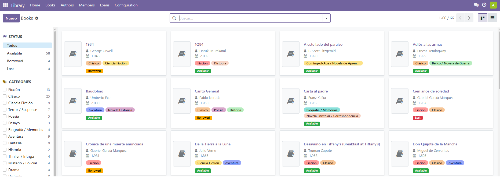
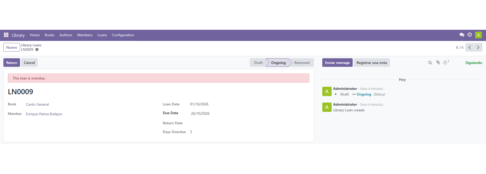
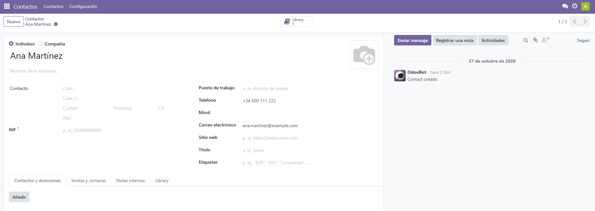

# Odoo Library Manager

Odoo 17 module to manage a small library: books, authors, categories, members and loans, with an OWL home dashboard, a PDF report, an optional AI category suggestion and ISBN autofill.

Built as a learning project to practise Odoo development (ORM, views, security, inheritance, OWL, QWeb and testing).

## Screenshots

<p>
  
  
</p>
<p>
  
  
</p>

## Features

- **Books**: title, ISBN, publication year, pages, author, categories, cover image and status (available / borrowed / lost).
  - Catalog-style kanban view (cards with cover thumbnails and a colour status label), plus list and form views.
  - Side filter panel (status and categories, with counters) to browse large catalogs.
  - *Mark as Lost* / *Recover* buttons with validation, loans smart button and chatter tracking. Borrow / Return are done through loans.
- **AI category suggestion**: a button asks the Google Gemini API to pick up to three **existing** categories from the book title, author, year and description (see [Enable the AI suggestion](#enable-the-ai-suggestion)).
- **ISBN autofill (Open Library)**: type the ISBN and press **Autofill from ISBN** to complete the title, author, year, pages and cover from the free Open Library API. It never overwrites fields you already filled (see [Autofill from ISBN](#autofill-from-isbn)).
- **Authors**: biography, birth date, book counter (smart button), total pages written and a **Print PDF** button for the author sheet.
- **Categories**: colour tags, many-to-many with books.
- **Members**: each member is linked to a contact (`res.partner`) through delegation inheritance (`_inherits`). An existing contact can be turned into a member from the contact list/form (*Action > Create library member*) without duplicating it. Automatic member number (`LM0001`), status (active / suspended) with Suspend / Activate buttons, archiving, loans smart button, and suspended members shown as *(Suspended)* in every dropdown.
- **Contacts (`res.partner`) extended** with `_inherit` and an XPath view inheritance: smart button and *Library* tab showing the contact's memberships.
- **Loans**: automatic reference (`LN0001`), book, member, loan / due / return dates (due date defaults to the configured loan period, 14 days by default) and status (draft / ongoing / returned / cancelled / lost).
  - *Confirm* checks that the member is active and borrows the book.
  - *Return* gives the book back and stores the return date.
  - *Cancel* releases the book if the loan was ongoing.
  - *Lost*: marking a book as lost closes its ongoing loan as `lost` (final state, kept as history of who had it). The book cannot then be returned or cancelled through that loan.
  - Date constraints: the due date and the return date cannot be earlier than the loan date (the same date is allowed).
  - Only draft loans can be deleted (`@api.ondelete`); the rest are history.
  - Computed *days overdue*, overdue warning in the form and an *Overdue* filter.
  - A daily scheduled job queues one overdue email per loan for members with an email address. Changing the due date re-arms the notice.
  - A second daily job **suspends members with an overdue loan** (even without an email), and marking a book as lost suspends the member who had it. The reason is logged in the member's chatter. A suspended member cannot borrow but can still return books.
  - **Reactivation is always manual** (*Activate* button): recovering a book does not reactivate the member, since a replacement copy does not forgive the member. If a member is reactivated while still holding an overdue loan, the next run suspends them again.
- **PDF report** (QWeb): author sheet with their books.
- **Home dashboard** (OWL client action, with SCSS): counters for books, members and loans (including overdue loans). Each card opens the matching list, already filtered.
- **Statistics** (read-only SQL-view model `library.loan.report`, graph and pivot views): loans per month, most borrowed books, most read authors, most active readers, loans by status and a pivot analysis. Rankings are limited to the top 10 so charts stay readable with large catalogs.
- **Menus** as top-bar tabs: Home, Books, Authors, Members, Loans, Statistics and a Configuration dropdown (Categories).
- **Settings screen** (*Settings > Library*): Gemini API key and model, default loan period and days of grace before suspending. The key and model keep the same system-parameter names, so existing installations need no migration.
- **Security**: two groups, *Library: Reader* (read only) and *Library: Librarian* (full access, includes contact management).
- **Demo data**: categories, authors, books, members and ~60 historical loans spread over the last months (so the statistics have something to show). It is only loaded in databases created with demo data.

## Overdue email notifications

Odoo checks overdue loans once a day. When an ongoing loan has passed its due date, it queues one email for the member, provided the member has an email address. The email is sent on the due date and does not wait for the grace period: the grace period only delays the automatic suspension (*Settings > Library*). A loan remains in the `ongoing` state; overdue is determined from its due date. The notification timestamp is stored on the loan so the daily job does not send duplicates (it is reset if the due date changes). The scheduled action is defined with `numbercall = -1`; without it Odoo 17 would run it once and then deactivate it. The email template is written in English and rendered in the member's language, so it can be translated like the rest of the module.

Configure an outgoing mail server in Odoo (Settings > Technical > Outgoing Mail Servers) and make sure the mail queue is running. Loans without a member email are skipped and can be notified later if an address is added.

## Structure

```
library_manager/
├── __manifest__.py
├── models/        author, book, category, member, loan, res_partner, loan_report (SQL view), res_config_settings
├── views/         views (incl. kanban and res.partner inheritance), actions and menus
├── report/        QWeb PDF report
├── security/      groups and access rules
├── data/          sequences, scheduled job, mail template and demo data
├── migrations/    data migrations between module versions
├── i18n/          translations (Spanish: `es.po`)
├── static/src/dashboard/   OWL component, template and styles
└── tests/         automated tests
```

## Concepts practised

- Relations: `Many2one`, `One2many`, `Many2many`.
- Computed and related fields, `@api.depends`, `@api.constrains`, SQL constraints.
- Inheritance: `_inherit` (mixins such as `mail.thread`, and extending `res.partner`), `_inherits` (delegation to `res.partner`) and view inheritance with XPath.
- `ir.sequence`, `@api.model_create_multi`, `@api.ondelete`, status workflows with buttons.
- Odoo 17 view syntax (`<tree>`, `invisible="state != 'draft'"`, no `attrs`), kanban, search views, search panel and chatter.
- Security groups and `ir.model.access.csv`.
- OWL 2 client action with the `orm` and `action` services, and SCSS.
- QWeb PDF reports.
- Reporting with a SQL-view model (`_auto = False`), graph and pivot views, window functions (`RANK`) for top-N rankings.
- `TransactionCase` tests, including mocking an external API.
- Calling an external API with the key stored in `ir.config_parameter`.
- A standard Odoo settings screen (`res.config.settings`) with `config_parameter` fields and the *Settings* app block.
- A public API without a key (Open Library), ISBN-10/13 check-digit validation and downloading an image.

## Install (Docker)

The project runs with Docker Compose (Odoo 17 + PostgreSQL 15). The module lives in `./extra-addons`, mounted at `/mnt/extra-addons`.

```bash
docker compose up -d
```

Open `http://localhost:8069`, create a database (tick *Demo data* if you want the sample records), then install **Library Manager** from Apps.

After changing the code:

```bash
docker compose restart web
docker compose exec web odoo -d YOUR_DB -u library_manager --stop-after-init \
    --db_host=db --db_user=odoo --db_password=odoo --no-http
docker compose restart web
```

Python changes need the restart **before** the update; XML and manifest changes need the update (`-u`). After changing JavaScript, hard-refresh the browser (Ctrl+Shift+R).

## Run the tests

Use a separate database so your real one is not touched:

```bash
docker compose run --rm web odoo -d test_library -i library_manager \
    --test-enable --test-tags /library_manager --stop-after-init --no-http
```

Once `test_library` exists, use `-u` instead of `-i`. A successful run ends with `0 failed, 0 error(s)`. The tests that simulate API failures mute the module's logger, so the log stays clean.

## Enable the AI suggestion

The feature uses the **Google Gemini API** (REST `generateContent`). It is optional: without a key the button shows a clear message and nothing else is affected.

1. Create a Gemini API key in [Google AI Studio](https://aistudio.google.com/apikey).
2. In Odoo, open **Settings > Library**.
3. Paste the key in **Gemini API Key** and save.
4. Optional: set **Gemini Model** to choose another model. The default is `gemini-3.5-flash-lite`; check in [Google's model list](https://ai.google.dev/gemini-api/docs/models) and [pricing](https://ai.google.dev/gemini-api/docs/pricing) that it is available for your project.
5. Open a book and press **Suggest Categories (AI)**.

The screen stores the values in the existing system parameters (`library_manager.gemini_api_key` and `library_manager.gemini_model`), so they can also be edited from *Settings > Technical > System Parameters*.

Notes:

- The book title, author, year and description are sent to Google when the button is pressed. The model can only choose among the categories that already exist in Odoo, and matches are **added** without removing the book's current categories.
- Only librarians can use the feature: the button is hidden for readers and the server also checks the group, so it cannot be triggered through RPC.
- The key is sent in the `x-goog-api-key` header (never in the URL) and must never be committed to Git.
- Free-tier usage is limited, and Google's terms for unpaid usage allow submitted content to be used to improve its products. Do not use it with real customer data.
- HTTP 404 usually means the model is not available for your key (change **Gemini Model** in *Settings > Library*); HTTP 429 means a quota or rate limit was reached.

## Autofill from ISBN

The **Autofill from ISBN** button next to the ISBN field completes a book from [Open Library](https://openlibrary.org/). It needs no key or configuration.

1. Open a book (or press *New*).
2. Type the ISBN, with or without hyphens.
3. Press **Autofill from ISBN**.

The button checks the ISBN check digit (ISBN-10 and ISBN-13), asks Open Library and fills the fields that are still empty. On an unsaved book it creates the book with the fetched title and reopens the form; on an existing book it only fills the gaps, so a title or author you already wrote is kept.

Notes:

- Only librarians can use it: the button is hidden for readers and the server checks the group too.
- The author is matched by name ignoring case and created only if it does not exist. Only the first author is used, because a book stores a single author.
- The cover is downloaded when it is an image of at most 5 MB. If the download fails, the rest of the data is still filled and the notification warns about it.
- Open Library is a free service without availability guarantees, and its data may be incomplete or differ from the printed edition. The description is not fetched because the endpoint used does not return it.

## Roadmap

- Timed suspensions that expire by themselves.
- Record rules / multi-company support.
- Translations to other languages. The source strings are in English; export a template with `odoo --modules=library_manager --i18n-export=xx.po -l xx_XX`.

## Notes

- Target version: **Odoo 17.0**. Syntax differs from other versions (for example, list views are `<list>` from Odoo 18).
- License: LGPL-3.
- Keep `odoo.conf` (with its `admin_passwd`) outside the module and out of version control; use an `odoo.conf.example` as a template.
