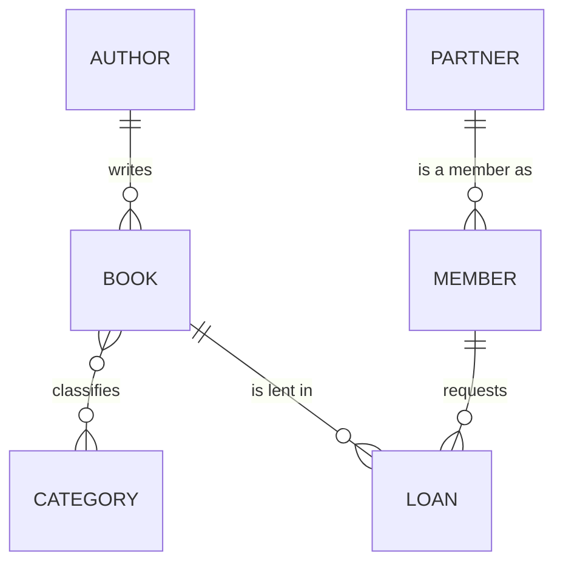
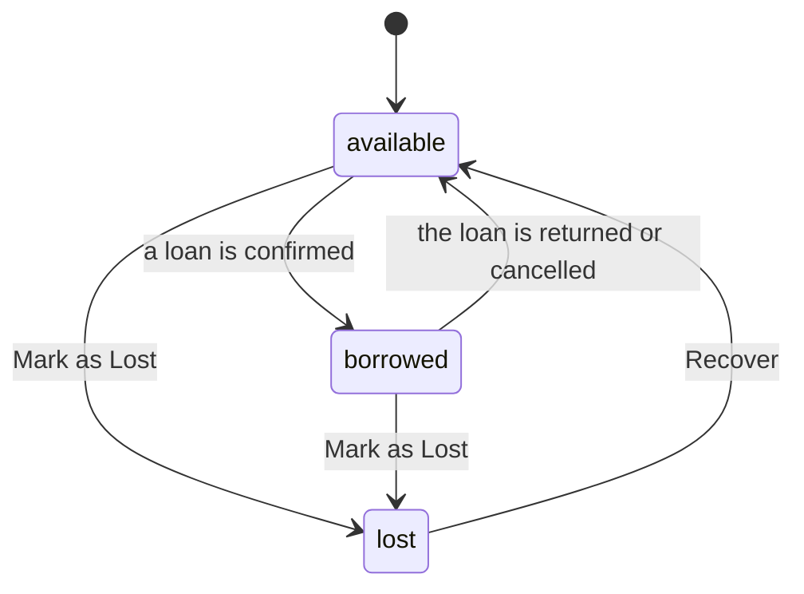
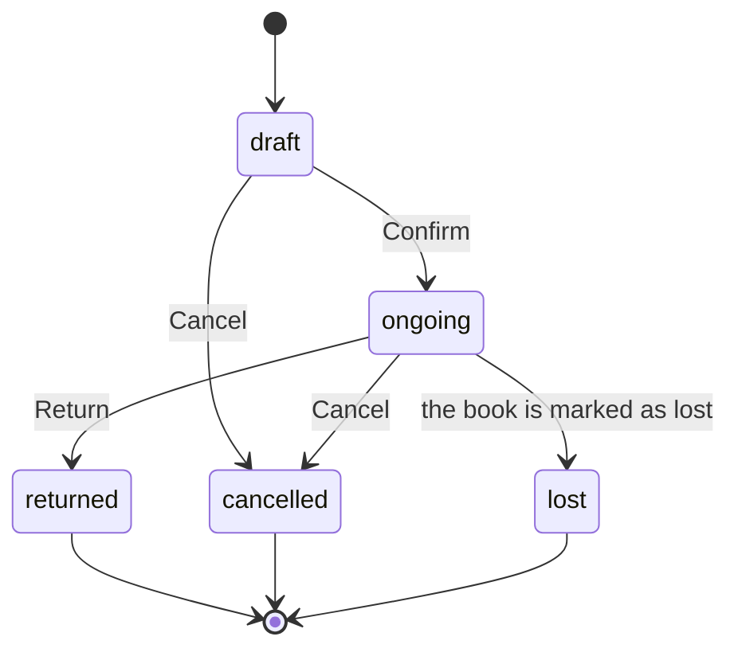

# Functional specification — Library Manager

| | |
|---|---|
| **Module** | `library_manager` |
| **Version described** | 17.0.2.1.0 |
| **Platform** | Odoo 17.0 (Community), PostgreSQL |
| **Dependencies** | `base`, `mail`; Python library `requests` |
| **License** | LGPL-3 |

This document describes **what the module does and which rules it follows**, not how to install it (that is in the [README](../README.md)). It reflects the behaviour of the code in the stated version: if the code and this document disagree, one of them has a bug and must be fixed.

[Appendix A](#appendix-a-code-map) maps each group of requirements to the files that implement it.

Every requirement has an identifier (`RF-…` functional, `RNF-…` non-functional; from the Spanish *requisito funcional / no funcional*) so it can be cited in commits, PRs and tests.

## Contents

1. [Objective and scope](#1-objective-and-scope)
2. [Roles and permissions](#2-roles-and-permissions)
3. [Data model](#3-data-model)
4. [Books](#4-books)
5. [Authors and categories](#5-authors-and-categories)
6. [Members and contacts](#6-members-and-contacts)
7. [Loans](#7-loans)
8. [Scheduled jobs](#8-scheduled-jobs)
9. [AI category suggestion](#9-ai-category-suggestion)
10. [Home dashboard](#10-home-dashboard)
11. [Statistics](#11-statistics)
12. [PDF report](#12-pdf-report)
13. [Non-functional requirements](#13-non-functional-requirements)
14. [Known limitations](#14-known-limitations)
15. [Glossary](#15-glossary)

- [Appendix A. Code map](#appendix-a-code-map)

---

## 1. Objective and scope

Manage a small library from Odoo: catalogue of books, authors, categories, members and loans, with automatic overdue notices and suspensions, usage statistics and a home dashboard.

**In scope**

- A catalogue with one record per book (each record is one lendable copy).
- The full loan cycle: draft, ongoing, returned, cancelled, lost.
- Members linked to Odoo contacts (`res.partner`).
- Email notices and automatic suspension for late returns.
- Statistics, a home dashboard and a PDF report per author.
- Optional category suggestion through the Google Gemini API.

**Out of scope** (not implemented)

- Several copies of the same title, reservations and waiting lists.
- Fines, payments or any accounting integration.
- Renewals as a flow of their own (the due date is edited by hand).
- A limit on simultaneous loans per member.
- Multi-company and record rules (`ir.rule`).
- Portal or web access for members.

## 2. Roles and permissions

There are two security groups. The **Library** menu is only visible to users who have at least the reader group.

| Group | Technical ID | Description |
|---|---|---|
| Library: Reader | `group_library_user` | Read-only. |
| Library: Librarian | `group_library_manager` | Full control. Includes the reader group and contact management (`base.group_partner_manager`). |

- **RF-SEG-01** The reader has read-only access to books, authors, categories, members, loans and statistics.
- **RF-SEG-02** The librarian can read, create, modify and delete books, authors, categories, members and loans.
- **RF-SEG-03** Statistics (`library.loan.report`) are read-only for everyone, including the librarian.
- **RF-SEG-04** The administrator (`base.user_admin`) and the superuser (`base.user_root`) are librarians when the module is installed.
- **RF-SEG-05** The library fields added to the contact (memberships and their counter) are only visible to users in the reader group or higher.
- **RF-SEG-06** The *Mark as Lost*, *Recover* and *Suggest Categories (AI)* buttons on the book are only shown to librarians.

## 3. Data model

| Model | Technical name | Notes |
|---|---|---|
| Book | `library.book` | With chatter (`mail.thread`). Ordered by title. |
| Author | `library.author` | Ordered by name. |
| Category | `library.category` | Coloured tag. |
| Member | `library.member` | Delegation inheritance (`_inherits`) from `res.partner`. With chatter. |
| Loan | `library.loan` | With chatter. Ordered by loan date, newest first. |
| Statistics | `library.loan.report` | Read-only SQL view (`_auto = False`). |
| Contact | `res.partner` | Extended with the library memberships. |

**Referential integrity** (`ondelete='restrict'`):

- **RF-DAT-01** An author who has books cannot be deleted.
- **RF-DAT-02** A book or a member who has loans cannot be deleted.
- **RF-DAT-03** A contact who is a member cannot be deleted.

## 4. Books

### 4.1 Data

Title (required), ISBN, publication year, pages, description, cover image (max. 1024 px, with a 128 px thumbnail), author, categories and status.

- **RF-LIB-01** The ISBN is unique across the whole catalogue.
- **RF-LIB-02** The same author cannot have two books with the same title.
- **RF-LIB-03** The number of pages cannot be negative.
- **RF-LIB-04** The publication year cannot be later than the current year. There is no lower limit, so ancient works can be catalogued.
- **RF-LIB-05** Changes of author and status are recorded in the chatter.
- **RF-LIB-06** The book shows how many loans it has had and lets you open them.

### 4.2 Statuses

- **RF-LIB-07** A new book starts as `available`.
- **RF-LIB-08** Only an `available` book can become `borrowed`, and only a `borrowed` one can go back to `available` through a return. In the interface these two changes are always made through a loan; the book has no buttons for them.
- **RF-LIB-09** *Mark as Lost* can be applied to an available or borrowed book. If the book is already lost, it is rejected with an error.
- **RF-LIB-10** When a borrowed book is marked as lost:
  1. its ongoing loan becomes `lost`;
  2. the member who had it is suspended, with the reason noted in their chatter (see RF-SOC-07);
  3. the book becomes `lost`.
- **RF-LIB-11** *Recover* only applies to lost books and leaves them `available`. It does **not** reopen the lost loan **nor** reactivate the member: the book may have been replaced with another copy, and that does not exempt the member.

### 4.3 Views

Catalogue-style kanban (cover and a coloured status label), list and form, with a side filter panel by status and category.

### 4.4 Autofill from ISBN

The *Autofill from ISBN* button next to the ISBN field completes a book from the [Open Library](https://openlibrary.org/) public API. It needs no key or configuration.

- **RF-ISBN-01** Only librarians can use it: the button is hidden for readers and the server checks the group too.
- **RF-ISBN-02** The ISBN is normalised first (spaces and hyphens removed, X in upper case) and its check digit is validated as ISBN-10 or ISBN-13. A missing or invalid ISBN is rejected before calling the API.
- **RF-ISBN-03** An ISBN that already belongs to another book is rejected before calling the API, with the title of the existing book. The normalised ISBN is what gets stored.
- **RF-ISBN-04** The action only fills **empty** fields; it never overwrites a value typed by the librarian.
- **RF-ISBN-05** It fills the title (only when empty), author, publication year, pages and cover. Since the title is required, pressing the button on an unsaved book creates it with the returned data and reopens the form.
- **RF-ISBN-06** The author is reused when a name matches ignoring case, and created otherwise. Only the first author is used, because the model stores one.
- **RF-ISBN-07** The cover is downloaded from the medium, large or small URL (in that order) and is skipped when it is empty, not an image or larger than 5 MB. A cover failure never blocks the rest of the fields; the notification then warns about it.
- **RF-ISBN-08** Timeouts (30 s), connection errors, HTTP errors and ISBNs without data are reported as clear messages, never as a traceback.
- **RF-ISBN-09** A notification lists the fields that were filled. If Open Library had data but everything was already filled, it says so with a warning.

The endpoint (`/api/books?bibkeys=ISBN:...&format=json&jscmd=data`) does not return the description, so that field is left untouched. Data quality and availability depend on Open Library, a free service without an SLA.

## 5. Authors and categories

**Authors**: name (required), birth date, biography and their books.

- **RF-AUT-01** The author's name is unique.
- **RF-AUT-02** The birth date cannot be in the future.
- **RF-AUT-03** The author shows how many books they have (with direct access to the list) and the total pages written, which is recalculated whenever the pages of any of their books change.
- **RF-AUT-04** The author's PDF report is printed from the author form (see section 12).

**Categories**: name (required), description and colour. Many-to-many relation with books. They are managed from *Configuration > Categories*.

## 6. Members and contacts

### 6.1 Members

A member is a library record linked to an Odoo contact. Personal data (name, email, phone, language…) lives in the contact; the member record adds the member number, join date, status, notes and their loans.

- **RF-SOC-01** When a member is created they are automatically given a sequential number in the format `LM0001`. The number is unique and is not copied when duplicating.
- **RF-SOC-02** The join date defaults to the day of creation.
- **RF-SOC-03** A member is `active` or `suspended`. They start as `active`. Status changes are recorded in the chatter.
- **RF-SOC-04** A suspended member **cannot start new loans**, but **can return** the ones they already have.
- **RF-SOC-05** A suspended member is marked as “Name (Suspended)” in every dropdown and search. The label follows the user's language (for example “Suspendido” in Spanish).
- **RF-SOC-06** The librarian can suspend and reactivate by hand with the *Suspend* and *Activate* buttons.
- **RF-SOC-07** The system automatically suspends an active member in two cases, always noting the reason in their chatter:
  - they have an ongoing loan whose due date has passed (daily job, RF-CRON-04);
  - a book they had on loan is marked as lost (RF-LIB-10).
- **RF-SOC-08** Reactivation is **always manual**. Neither returning the book nor recovering it reactivates the member. If a member who still has an overdue loan is reactivated, the next run of the daily job suspends them again.
- **RF-SOC-09** A member can be archived (`active` field) without deleting them.
- **RF-SOC-10** The member shows how many loans they have had and lets you open them.

### 6.2 Contacts

- **RF-CON-01** A contact who is a member shows a smart button and a *Library* tab listing their memberships. Both are hidden for contacts without any membership.
- **RF-CON-02** From the contact list or form, *Action > Create library member* turns the selected contacts into members **without duplicating the contact**.
- **RF-CON-03** That action skips contacts who are already members, even if the member is archived. If all the selected contacts already were, it is rejected with an error.
- **RF-CON-04** If a single member is created its form is opened; if several are created, the list is opened.

## 7. Loans

### 7.1 Data

Reference, book, member, loan date, due date, return date, status and days overdue.

- **RF-PRE-01** Every loan gets an automatic, read-only reference in the format `LN0001`.
- **RF-PRE-02** The loan date defaults to today; the due date, to today + the configured loan period (14 days by default, see section 8.3).
- **RF-PRE-03** The due date cannot be earlier than the loan date (the same day is allowed).
- **RF-PRE-04** The return date cannot be earlier than the loan date (the same day is allowed).
- **RF-PRE-05** When choosing a book in the form, only `available` books are offered.
- **RF-PRE-06** Book, member and loan date can only be edited in draft. The due date can be edited in draft and while ongoing.
- **RF-PRE-07** Changes of book, member, return date and status are recorded in the chatter.

### 7.2 Statuses and transitions

| Action | Starting status | Conditions | Effect |
|---|---|---|---|
| **Confirm** | `draft` | The member is `active` and the book `available`. | Book → `borrowed`; loan → `ongoing`. |
| **Return** | `ongoing` | — | Book → `available`; loan → `returned`; return date = today. |
| **Cancel** | `draft` or `ongoing` | — | If it was ongoing and the book is still `borrowed`, the book → `available`. Loan → `cancelled`. |
| *(automatic)* | `ongoing` | The book is marked as lost. | Loan → `lost`; member suspended. |

- **RF-PRE-08** Any action launched from a status where it is not allowed is rejected with an error message, without changing anything.
- **RF-PRE-09** `returned`, `cancelled` and `lost` are final statuses. In particular, a `lost` loan cannot be returned or cancelled: it stays as a record of who had the book.
- **RF-PRE-10** Only draft loans can be deleted. The rest are history.
- **RF-PRE-11** If you try to confirm a draft for a suspended member, the form warns you beforehand and the confirmation is rejected.

### 7.3 Overdue

A loan is **overdue** when it is `ongoing` and its due date is **before** today. The due date itself does not yet count as late. “Overdue” is not a status: it is derived from the date.

- **RF-PRE-12** Days overdue are calculated as follows and are never negative:

  | Status | Days overdue |
  |---|---|
  | `ongoing` | today − due date |
  | `returned` | return date − due date |
  | any other | 0 |

- **RF-PRE-13** The form shows a warning on overdue loans, and the list offers the *Overdue* filter.

## 8. Scheduled jobs

Two independent daily jobs, active from installation and with no limit on executions (`numbercall = -1`).

### 8.1 Overdue email notice

- **RF-CRON-01** Once a day, one email is queued for each overdue loan that has not been notified yet and whose member has an email address.
- **RF-CRON-02** Each loan is notified **only once**: when the email is queued, the date and time of the notice are stored. Loans of members without an email are skipped without being marked, so they will be notified if an address is added later.
- **RF-CRON-03** Changing the due date clears the notice mark: if the loan becomes overdue again, it is notified again.
- The email uses the *Library: Overdue loan notice* template (book, reference and due date), written in English and rendered in the member's language. It is queued; actual delivery depends on the outgoing mail server configured in Odoo.

### 8.2 Suspension for lateness

- **RF-CRON-04** Once a day, every active member with at least one loan overdue by more than the configured grace period is suspended, **whether or not they have an email**, and the loan, the book and the due date that caused it are noted in their chatter.
- **RF-CRON-05** A member who is already suspended is not processed again and does not receive duplicate messages.
- **RF-CRON-06** The grace period delays **only the suspension**, not the overdue email of section 8.1, which is queued from the due date.

### 8.3 Settings screen

*Settings > Library* groups the module options. They are stored in `ir.config_parameter` under the existing `library_manager.*` keys, so installations upgrading from previous versions keep their values.

| Setting | Parameter | Default | Effect |
|---|---|---|---|
| Gemini API Key | `library_manager.gemini_api_key` | — | Enables the AI category suggestion (section 9). |
| Gemini Model | `library_manager.gemini_model` | `gemini-3.5-flash-lite` | Model used by the AI suggestion. |
| Default Loan Period | `library_manager.loan_days` | 14 | Due date of new loans. |
| Grace Period Before Suspension | `library_manager.grace_days` | 0 | Days after the due date before the suspension job acts. |

- **RF-SET-01** The loan period must be at least 1 day and the grace period cannot be negative. Any other value is rejected when saving.
- **RF-SET-02** Changing the loan period affects only loans created afterwards; existing loans keep their due date.
- **RF-SET-03** If a parameter is manually edited to something that is not a valid integer, the module falls back to the default (14 days of loan, 0 days of grace) instead of failing.
- **RF-SET-04** The Settings app is restricted to administrators; the values are global parameters, not per company.

## 9. AI category suggestion

Optional feature. The *Suggest Categories (AI)* button on the book asks the Google Gemini API to choose categories from the title, author, year and description.

### 9.1 Configuration

Configured in *Settings > Library* (see section 8.3) and stored as system parameters (*Settings > Technical > System Parameters*):

| Key | Required | Default value |
|---|---|---|
| `library_manager.gemini_api_key` | Yes | — |
| `library_manager.gemini_model` | No | `gemini-3.5-flash-lite` |

### 9.2 Behaviour

- **RF-IA-01** Only librarians can use the feature. It is checked on the server in addition to hiding the button, so a reader cannot invoke it through RPC either.
- **RF-IA-02** Without a configured key, the action stops with a message pointing to *Settings > Library*. The rest of the module is unaffected.
- **RF-IA-03** The model name must start with `gemini-` and contain only letters, numbers, `-`, `_` and `.`. Any other value is rejected before calling the API.
- **RF-IA-04** If no category exists, the action stops and asks you to create some first.
- **RF-IA-05** The model can only choose among **already existing** categories. Names it returns that match none are discarded. The comparison ignores case and surrounding whitespace.
- **RF-IA-06** At most **3** categories are added, and only the first three names returned by the model are considered. They are **added** to those the book already had: none is ever removed.
- **RF-IA-07** The result is reported with a notification: a success one with the added categories, or a warning if no suggestion matches.
- **RF-IA-08** All failures are shown as understandable messages, never as a traceback:

  | Situation | Message to the user |
  |---|---|
  | No response within 30 s | Timed out; try again. |
  | Network error | Could not connect; check the server's connection. |
  | HTTP 400 | Gemini rejected the request. |
  | HTTP 401 / 403 | Authentication or permission error; check the key. |
  | HTTP 404 | Model not found or not available for the key. |
  | HTTP 429 | Quota or rate limit exceeded. |
  | Other HTTP | Generic error with the code. |
  | Empty response, no candidates, or not a JSON list of strings | Invalid category response. |

### 9.3 Security and privacy

- **RNF-IA-01** The key is sent in the `x-goog-api-key` header, never in the URL, and is not written to the logs.
- **RNF-IA-02** Only the title, author, year and description of the book, plus the list of category names, are sent to Google. No member or loan data is sent.

## 10. Home dashboard

First tab of the menu (*Home*). OWL component that shows grouped counters:

| Section | Cards |
|---|---|
| Books | Total, Available, Borrowed, Lost |
| Members | Active members, Suspended |
| Loans | Ongoing, Overdue, Returned |

- **RF-PAN-01** Each card shows the number of records that meet its filter, and clicking it opens the matching list with that same filter applied.
- **RF-PAN-02** The *New Loan* and *New Book* shortcuts are only shown to users who have create permission on the model, so a reader is not offered buttons that would end in an error.

## 11. Statistics

*Statistics* menu, on the read-only model `library.loan.report`.

| Submenu | Report | Initial view |
|---|---|---|
| Popularity | Most Borrowed Books | Lines: loans per month and book |
| Popularity | Most Read Authors | Lines: loans per month and author |
| Popularity | Most Active Readers | Lines: loans per month and member |
| Activity | Loans per Month | Lines: loans per month |
| Activity | Loans by Status | Pie chart by status |
| Activity | Loan Analysis | Pivot table: books × months |

- **RF-EST-01** Only `ongoing`, `returned` and `lost` loans count. Drafts and cancelled loans do not appear in any statistic.
- **RF-EST-02** Available measures: number of loans, number of overdue loans and average days late. The days late of a loan are `max(return date or, if there is none, today − due date, 0)`; lost loans do not enter that average.
- **RF-EST-03** The three popularity reports open limited to the **Top 10**, and offer Top 5 / 10 / 20 / 50 filters to change it.
- **RF-EST-04** Ranking positions are calculated over the full history and without ties: with the same number of loans, the order is by identifier. They are not recalculated when other filters (for example, a date range) are applied.
- **RF-EST-05** All reports can be filtered by *Ongoing*, *Returned* and *Overdue*, and grouped by book, author, member, month and status. There is no filter for lost loans; they can be seen by grouping by status.

## 12. PDF report

- **RF-INF-01** From an author's form, *Print PDF* generates a QWeb report with the author's data and the list of their books.

## 13. Non-functional requirements

- **RNF-01 Compatibility.** Odoo 17.0. View syntax is that of this version (`<tree>`, `invisible="…"` without `attrs`); operation on other versions is not guaranteed.
- **RNF-02 Language.** Source texts are in English and translatable. A Spanish translation is included (`i18n/es.po`).
- **RNF-03 Testing.** The module includes automated tests (`TransactionCase`) covering books, authors, members, contacts, loans, settings, statistics, the Gemini integration and the Open Library integration (both external APIs mocked). Every behaviour change must come with its tests, and the suite must finish with `0 failed, 0 error(s)`.
- **RNF-04 Migrations.** Data changes between versions are done with scripts in `migrations/`. Version 17.0.2.1.0 moves the ongoing loans of books that were already marked as lost to `lost`. Version 17.0.2.2.0 adds the settings screen; it needs no data migration because it reuses the existing parameter keys. Version 17.0.2.3.0 adds the ISBN autofill; it changes no stored data either.
- **RNF-05 Demo data.** Categories, authors, books, members and about 60 historical loans, loaded only in databases created with demo data.
- **RNF-06 Secrets.** Neither the Gemini key nor `odoo.conf` is stored in the repository.
- **RNF-07 Performance.** Counters (loans per book and per member, books per author, memberships per contact) are computed with one grouped query per batch, not one query per record.

## 14. Known limitations

Current behaviours worth knowing about. They are not requirements: they are open points that a future version may change.

1. **A draft does not reserve the book.** Several draft loans can exist for the same book; only the first one to be confirmed will succeed and the rest will fail on confirmation.
2. **A contact can end up with more than one member record.** The *Create library member* action prevents it, but there is no database constraint that stops it by other means.
3. **“Today” is not the same everywhere.** The home dashboard computes overdue loans with the browser's date, the server with the user's time zone and the statistics with the database date. Near midnight they can differ by a day.
4. **Suspensions do not expire by themselves.** The grace period delays the suspension, but once a member is suspended only a librarian can reactivate them.
5. **The email notice is marked when queued**, not when delivered. If the mail server fails afterwards, the notice is not retried by the module.
6. **No record rules or multi-company.** All users with access see all records.
7. **ISBN uniqueness is textual.** Two books can coexist with the same ISBN written with and without hyphens; the autofill normalises the ISBN of the book being edited and only compares normalised values.
8. **The ISBN autofill depends on Open Library.** Its metadata can be incomplete or differ from the printed edition (for example the publication year), and the description is not fetched because the endpoint does not return it.

Planned lines of evolution (see the README *Roadmap*): temporary suspensions, record rules and multi-company, and more translations.

## 15. Glossary

| Term | Meaning |
|---|---|
| **Member** | A person registered in the library (`library.member`), linked to a contact. |
| **Contact** | An Odoo `res.partner` record holding the personal data. |
| **Ongoing loan** | A loan that has been confirmed and not yet returned (`ongoing`). |
| **Overdue** | An ongoing loan whose due date is before today. |
| **Suspended** | A member who cannot start new loans until a librarian reactivates them. |
| **Chatter** | The history of messages and changes that Odoo shows on a record's form. |
| **Scheduled job** | A periodic automatic action in Odoo (`ir.cron`). |

---

## Appendix A. Code map

Where each group of requirements lives, so a change can start from the right files. Paths are relative to the module root. Method names are the real ones in the code.

| Area (IDs) | Business logic | Views / data | Tests |
|---|---|---|---|
| **Security** (`RF-SEG`) | `security/library_security.xml` (groups, default users), `security/ir.model.access.csv` (access rights). Group checks in `models/res_partner.py` (field `groups=`) and `models/book.py` (`action_suggest_categories`, `_check_isbn_access`). | `groups=` attributes in `views/*.xml` | `tests/test_ai.py`, `tests/test_isbn.py` (reader vs librarian) |
| **Data integrity** (`RF-DAT`) | `ondelete='restrict'` on `author_id` (`models/book.py`), `book_id` and `member_id` (`models/loan.py`), `partner_id` (`models/member.py`) | — | per model |
| **Books** (`RF-LIB`) | `models/book.py`: `_sql_constraints` (ISBN, title + author), `_check_publication_year`, `action_borrow`, `action_return`, `action_mark_lost`, `action_recover`, `action_view_loans`, `_compute_loan_count` | `views/library_book_views.xml` | `tests/test_book.py` |
| **Authors and categories** (`RF-AUT`) | `models/author.py`: `_sql_constraints`, `_check_birth_date`, `_compute_book_count`, `_compute_total_pages`, `action_view_author_books`, `action_print_report`. Categories: `models/category.py` | `views/library_author_views.xml`, `views/library_category_views.xml` | `tests/test_author.py` |
| **Members** (`RF-SOC`) | `models/member.py`: `create` (assigns the number), `_compute_display_name`, `action_suspend`, `action_activate`, `action_view_loans`, `_sql_constraints` (unique number). Automatic suspension: `models/loan.py::_suspend_member` and `models/book.py::action_mark_lost` | `views/library_member_views.xml`, `data/library_sequence.xml` | `tests/test_member.py`, `tests/test_loan.py` |
| **Contacts** (`RF-CON`) | `models/res_partner.py`: `_compute_library_member_count`, `action_view_library_member`, `action_create_library_member` | `views/library_partner_views.xml` (smart button, *Library* tab, server action) | `tests/test_partner.py` |
| **Loans** (`RF-PRE`) | `models/loan.py`: `_compute_days_overdue`, `_check_dates`, `_unlink_only_draft`, `create` (assigns the reference), `write` (clears the overdue notice mark), `action_confirm`, `action_return`, `action_cancel` | `views/library_loan_view.xml`, `data/library_loan_sequence.xml` | `tests/test_loan.py` |
| **Scheduled jobs** (`RF-CRON`) | `models/loan.py`: `_cron_send_overdue_emails`, `_cron_suspend_overdue_members`, `_suspend_member` | `data/library_cron.xml` (both jobs, `numbercall = -1`), `data/library_mail_template.xml` | `tests/test_loan.py` |
| **Settings** (`RF-SET`) | `models/res_config_settings.py` (`config_parameter` fields and constraints), `models/loan.py` (`_get_int_setting`, `_default_due_date`, grace in `_cron_suspend_overdue_members`) | `views/res_config_settings_views.xml` | `tests/test_settings.py` |
| **AI suggestion** (`RF-IA`) | `models/book.py::action_suggest_categories` (key and model lookup, prompt, HTTP call, error handling and matching all live in this one method) | Button in `views/library_book_views.xml` | `tests/test_ai.py` |
| **ISBN autofill** (`RF-ISBN`) | `models/book.py`: `_normalize_isbn`, `_is_valid_isbn`, `_extract_publication_year`, `_check_isbn_access`, `_get_or_create_author`, `_fetch_open_library_data`, `_fetch_cover_image`, `_prepare_isbn_values`, `action_fill_from_isbn` | Button in `views/library_book_views.xml` | `tests/test_isbn.py` |
| **Dashboard** (`RF-PAN`) | `static/src/dashboard/dashboard.js` (cards, counters, permission checks) | `static/src/dashboard/dashboard.xml`, `dashboard.scss`, `views/library_dashboard_views.xml` | none (JavaScript is not covered) |
| **Statistics** (`RF-EST`) | `models/loan_report.py`: `_query` (the SQL view, including the rankings) and `init` | `views/library_report_views.xml`, `views/library_menus.xml` | `tests/test_report.py` |
| **PDF report** (`RF-INF`) | `models/author.py::action_print_report` | `report/library_author_report.xml` | — |
| **Non-functional** (`RNF`) | Translations: `i18n/es.po`. Migrations: `migrations/`. Counters: `_read_group` in `models/book.py`, `author.py`, `member.py` and `res_partner.py` | Demo data: `data/library_demo_data.xml`, `library_member_demo.xml`, `library_loan_demo.xml` | all |

### Changes that touch several places

- **A new loan status** (as `lost` was): the `Selection` in `models/loan.py`; the status lists inside the SQL of `models/loan_report.py` (the `IN ('ongoing', 'returned', 'lost')` appears in **three** places, and `loan_state` has its own `Selection`); badge, alert and filter in `views/library_loan_view.xml`; a migration if existing data must change; tests; `i18n/es.po`; this document.
- **A new setting**: a field with `config_parameter` in `models/res_config_settings.py`, a `<setting>` element in `views/res_config_settings_views.xml`, the read in the place it applies (fall back to the default, as `models/loan.py::_get_int_setting` does), a test in `tests/test_settings.py`, `i18n/es.po` and this document.
- **A new user-visible text**: add it in English in the code and add its translation to `i18n/es.po`. Keys that already exist in other Odoo modules can collide in the dashboard's JavaScript (that is why the card says “Overdue loans”).
- **A new external API call**: keep the request in the model, set a timeout, catch `requests.exceptions.Timeout` and `RequestException`, turn HTTP and parsing errors into `UserError`, and test every branch with `unittest.mock.patch` (see `tests/test_ai.py` and `tests/test_isbn.py`).
- **A new field on the member**: avoid labels equal to those of `res.partner` (Odoo warns about duplicated labels because of the `_inherits`; “Contact” and “Notes” had to be renamed for that reason).

### Pitfalls already hit

- **A cron without `numbercall = -1` runs only once** in Odoo 17 and then deactivates itself.
- **Tests must not compare translated text.** Once `es.po` exists, the test user may see Spanish; compare states or types of exception instead.
- **`display_name` is translated**, so its compute declares `@api.depends_context('lang')`; without it, the cache mixes languages.
- **Tests that simulate Gemini failures mute the module logger** (`mute_logger`) to keep the log clean.
- **A member suspended by a late loan is suspended again the next day** if a librarian reactivates them before the book is returned; this is intended (RF-SOC-08).
