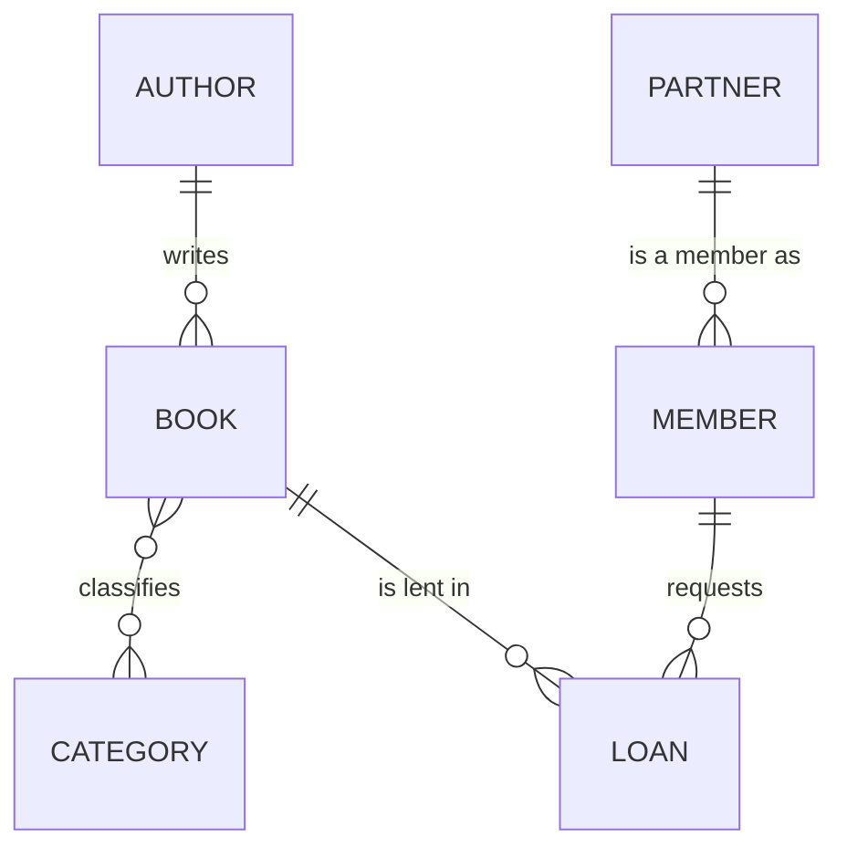
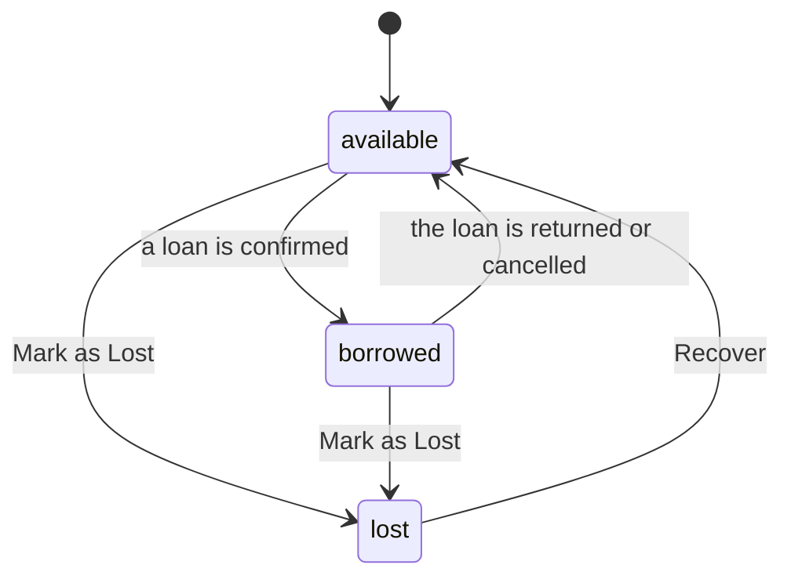
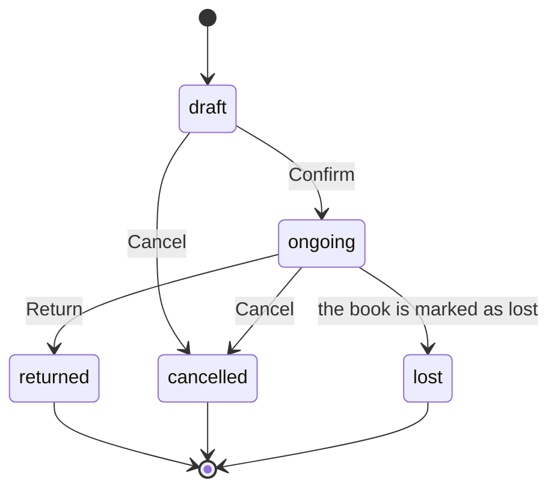

# Functional specification — Library Manager

| | |
|---|---|
| **Module** | `library_manager` |
| **Version described** | 17.0.2.24.0 |
| **Platform** | Odoo 17.0 (Community), PostgreSQL |
| **Dependencies** | `base`, `mail`; Python library `requests` |
| **License** | LGPL-3 |

This document describes **what the module does and which rules it follows**, not how to install it (that is in the [README](../README.md)). It reflects the behaviour of the code in the stated version: if the code and this document disagree, one of them has a bug and must be fixed.

[Appendix A](#appendix-a-code-map) maps each group of requirements to the files that implement it.

Every requirement has an identifier (`RF-…` functional, `RNF-…` non-functional; from the Spanish *requisito funcional / no funcional*) so it can be cited in commits, PRs and tests.

## Contents

1. [Objective and scope](#1-objective-and-scope)
2. [Roles and permissions](#2-roles-and-permissions)
3. [Data model](#3-data-model)
4. [Books](#4-books)
5. [Authors and categories](#5-authors-and-categories)
6. [Members and contacts](#6-members-and-contacts)
7. [Loans](#7-loans)
8. [Scheduled jobs](#8-scheduled-jobs)
9. [AI category suggestion](#9-ai-category-suggestion)
10. [Home dashboard](#10-home-dashboard)
11. [Statistics](#11-statistics)
12. [PDF report](#12-pdf-report)
13. [Non-functional requirements](#13-non-functional-requirements)
14. [Known limitations](#14-known-limitations)
15. [Glossary](#15-glossary)

- [Appendix A. Code map](#appendix-a-code-map)

---

## 1. Objective and scope

Manage a small library from Odoo: catalogue of books, authors, categories, members and loans, with automatic overdue notices and suspensions, usage statistics and a home dashboard.

**In scope**

- A catalogue with one record per book (each record is one lendable copy).
- The full loan cycle: draft, ongoing, returned, cancelled, lost.
- Members linked to Odoo contacts (`res.partner`).
- Email notices and automatic suspension for late returns.
- Statistics, a home dashboard and a PDF report per author.
- Optional category suggestion through the Google Gemini API.
- Autofill of book and author metadata from the Open Library public API, one record at a time or through a background queue.

**Out of scope** (not implemented)

- Several copies of the same title, reservations and waiting lists.
- Fines, payments or any accounting integration.
- Renewals as a flow of their own (the due date is edited by hand).
- A limit on simultaneous loans per member.
- Multi-company and record rules (`ir.rule`).
- Portal or web access for members.

## 2. Roles and permissions

There are two security groups. The **Library** menu is only visible to users who have at least the reader group.

| Group | Technical ID | Description |
|---|---|---|
| Library: Reader | `group_library_user` | Read-only. |
| Library: Librarian | `group_library_manager` | Full control. Includes the reader group and contact management (`base.group_partner_manager`). |

- **RF-SEG-01** The reader has read-only access to books, authors, categories, members, loans and statistics.
- **RF-SEG-02** The librarian can read, create, modify and delete books, authors, categories, members and loans.
- **RF-SEG-03** Statistics (`library.loan.report`) are read-only for everyone, including the librarian.
- **RF-SEG-04** The administrator (`base.user_admin`) and the superuser (`base.user_root`) are librarians when the module is installed.
- **RF-SEG-05** The library fields added to the contact (memberships and their counter) are only visible to users in the reader group or higher.
- **RF-SEG-06** The *Mark as Lost*, *Recover* and *Suggest Categories (AI)* buttons on the book are only shown to librarians.
- **RF-SEG-07** The Open Library refresh queue (`library.metadata.refresh`) is read-only and only visible to librarians, and so is its menu entry *Open Library Refreshes*. Jobs are created by the *Queue Open Library Refresh* actions, which check on the server that the user is a librarian before creating them with elevated rights.

## 3. Data model

| Model | Technical name | Notes |
|---|---|---|
| Book | `library.book` | With chatter (`mail.thread`). Ordered by title. |
| Author | `library.author` | With chatter (`mail.thread`) and photo. Ordered by name; optional unique Open Library ID. |
| Category | `library.category` | Name and description; displayed as an uncoloured tag. |
| Member | `library.member` | Delegation inheritance (`_inherits`) from `res.partner`. With chatter. |
| Loan | `library.loan` | With chatter. Ordered by loan date, newest first. |
| Statistics | `library.loan.report` | Read-only SQL view (`_auto = False`). |
| Refresh job | `library.metadata.refresh` | Queue of Open Library refreshes. Each job targets exactly one book or one author. Newest first. No chatter. |
| Contact | `res.partner` | Extended with the library memberships. |

Books, authors and members also store a computed *Initial* (`name_initial`): the first letter of the title or name in capitals and without accents (`A`–`Z`), or `#` for digits, symbols and non-Latin alphabets. It feeds the side filter panel of their list views.

**Referential integrity** (`ondelete='restrict'`):

- **RF-DAT-01** An author who has books cannot be deleted.
- **RF-DAT-02** A book or a member who has loans cannot be deleted.
- **RF-DAT-03** A contact who is a member cannot be deleted.
- **RF-DAT-04** Deleting a book or an author also deletes its refresh jobs (`ondelete='cascade'`).

## 4. Books

### 4.1 Data

Title (not enforced as required, so that a new book can be started from an ISBN or an Open Library ID alone; see section 4.4), ISBN, optional Open Library ID (work `OL…W` or edition `OL…M`), edition publication year, first publication year, publisher, publication place, language code, physical format, Dewey and Library of Congress classifications, pages, description, cover image (max. 1024 px, with a 128 px thumbnail), author, categories and status.

- **RF-LIB-01** The ISBN is unique across the whole catalogue.
- **RF-LIB-02** The same author cannot have two books with the same title. The rule is a database constraint, so it does not apply to books without an author or without a title.
- **RF-LIB-03** The number of pages cannot be negative.
- **RF-LIB-04** The publication year cannot be later than the current year. There is no lower limit, so ancient works can be catalogued (autofill, however, ignores years before 1000).
- **RF-LIB-05** Changes of author and status are recorded in the chatter.
- **RF-LIB-06** The book shows how many loans it has had and lets you open them.

### 4.2 Statuses

- **RF-LIB-07** A new book starts as `available`.
- **RF-LIB-08** Only an `available` book can become `borrowed`, and only a `borrowed` one can go back to `available` through a return. In the interface these two changes are always made through a loan; the book has no buttons for them.
- **RF-LIB-09** *Mark as Lost* can be applied to an available or borrowed book. If the book is already lost, it is rejected with an error.
- **RF-LIB-10** When a borrowed book is marked as lost:
  1. its ongoing loan becomes `lost`;
  2. the member who had it is suspended, with the reason noted in their chatter (see RF-SOC-07);
  3. the book becomes `lost`.
- **RF-LIB-11** *Recover* only applies to lost books and leaves them `available`. It does **not** reopen the lost loan **nor** reactivate the member: the book may have been replaced with another copy, and that does not exempt the member.

### 4.3 Views

Catalogue-style kanban (cover and a coloured status label), list and form, with a side filter panel by initial letter of the title and by status (both with counters).

### 4.4 Autofill from ISBN or Open Library ID

The *Autofill from ISBN or Open Library ID* button in the book form header completes a book from the [Open Library](https://openlibrary.org/) public API. It needs no key or configuration. The Open Library ID may identify a work (`OL…W`) or an edition (`OL…M`); when both ISBN and ID are provided, it queries the ISBN first, supplements missing data from its matching Open Library record, and falls back to the supplied ID if the ISBN has no record.

- **RF-ISBN-01** Only librarians can use it: the button is hidden for readers and the server checks the group too.
- **RF-ISBN-02** ISBN lookup normalises spaces and hyphens and uppercases the value (so a lowercase `x` check digit works), then validates the ISBN-10 or ISBN-13 check digit; an ISBN-13 must start with 978 or 979. Alternatively, lookup accepts a work ID (`OL…W`) or edition ID (`OL…M`), also when it is pasted as an Open Library URL or path (for example `/works/OL123W` or `https://openlibrary.org/books/OL123M.json`), and rejects malformed IDs before calling the API.
- **RF-ISBN-03** An ISBN that already belongs to another book is rejected before calling the API, with the title of the existing book. The normalised ISBN is what gets stored.
- **RF-ISBN-04** The action refreshes every supported bibliographic field for which Open Library returns a usable value, overwriting differing local values and making no write when they match. If Open Library has no usable value for a populated local field, it keeps that value and lists the field in a chatter note.
- **RF-ISBN-05** It refreshes the title (including subtitle when available), ISBN, Open Library ID, author, edition and first publication years, publisher, publication place, language code, physical format, classification, pages, description, cover and up to three categories from the returned subjects. Existing categories are matched by normalized name; missing categories are created and linked. The selected subject set replaces the book's previous categories. The publication year is read from the edition's publish date, falling back to the first publication date; only four-digit years from 1000 up to the current year are accepted. Since a title is needed to save the book, pressing the button on an unsaved book creates it with the returned data and reopens the form. It does not alter circulation status.
- **RF-ISBN-06** An author is created only when no local author matches (see RF-ISBN-10 for the matching rules). Only the first author is used, because the model stores one.
- **RF-ISBN-07** The cover URL is the first available of medium, large and small in the response; for a work or edition ID it is the medium image of the record's first valid cover (falling back to its work). The cover is skipped when it is empty, is not an image (by `Content-Type`) or is larger than 5 MB. A cover failure never blocks the rest of the fields; the notification then warns about it and the existing cover is kept.
- **RF-ISBN-08** Timeouts (30 s), connection errors, HTTP errors and ISBNs without data are reported as clear messages, never as a traceback. For a saved book the failure is shown as a persistent warning notification and noted in the chatter together with the local values that were kept; in a queued job the same message is stored on the job, which is marked *Failed*.
- **RF-ISBN-09** A notification and chatter note list changed fields, retained local values and applicable conflicts or download errors; unchanged values are not written.
- **RF-ISBN-10** When the book response provides an author key, the module fetches that author's record and stores the key uniquely on `library.author`. Existing authors are matched by key first, then by normalized name and aliases; multiple possible matches stop autofill with an explanation rather than creating a duplicate.
- **RF-ISBN-11** The matching author's name, birth and death dates, biography, alternate names, external links and photo are refreshed when Open Library supplies usable values. Unparseable birth dates are ignored; an unavailable author record does not prevent the book metadata from being filled.
- **RF-ISBN-12** An Open Library work ID is fetched from the Works API; an edition ID is fetched from the Editions API. Edition lookup uses its parent work for author and subject data when needed. When both identifiers are present, the ISBN result is primary and the matching Open Library record supplements missing fields; a missing ISBN result falls back to the saved ID.
- **RF-ISBN-13** Open Library IDs are stored on books but are not unique: several physical copies may refer to the same work. A work or edition lookup can fill title, author, year, pages, cover and description when supplied. An edition lookup also stores its valid ISBN when available and not assigned to another local book; work IDs do not select an arbitrary ISBN from their many editions.
- **RF-ISBN-14** Librarians can select books in the list and queue a metadata refresh, including selecting all books when a full refresh is needed. Books without an ISBN or Open Library ID are skipped (the notification says how many) and books that already have a queued or processing job are not queued again. If nothing is selected, or none of the selected books is eligible, the action is rejected with an error. Refresh jobs overwrite local fields when Open Library supplies values.
- **RF-ISBN-15** Refresh jobs run in the background in batches of up to ten per minute (see section 8.4), with each job's start and result committed separately so progress remains visible. A job is *Queued*, *Processing*, *Done* or *Failed*. In queued runs the module waits one second before every request to Open Library. State, result message and estimated processing time are available to librarians under *Library > Configuration > Open Library Refreshes*. The estimate uses queue position, the next scheduled cron run and the average duration of the last 20 completed jobs (20 seconds when there is none). Jobs left in progress for more than ten minutes are requeued automatically.
- **RF-ISBN-16** Individual and queued book refreshes use the same field mapping and overwrite rules. They record changed fields, locally retained fields without a usable Open Library value, ISBN conflicts and cover-download failures in the book chatter.

The ISBN endpoint (`/api/books?bibkeys=ISBN:...&format=json&jscmd=data`) does not return the description. Work and edition records may include it. Data quality and availability depend on Open Library, a free service without an SLA.

## 5. Authors and categories

**Authors**: name (required), photo, birth and death dates, biography, alternate names, external links, optional unique Open Library ID and their books. Autofill refreshes available author details and downloads the linked Open Library photo when present. List, kanban and form views display or edit the photo. The author list has a side filter panel by initial letter. Empty optional values (Open Library ID, birth and death dates) are shown as “NA” in read-only mode by the module's field widgets.

- **RF-AUT-01** The author's name is unique.
- **RF-AUT-02** The birth date cannot be in the future.
- **RF-AUT-03** The author shows how many books they have (with direct access to the list) and the total pages written, which is recalculated whenever the pages of any of their books change.
- **RF-AUT-04** The author's PDF report is printed from the author form (see section 12).
- **RF-AUT-05** Librarians can use *Autofill from Open Library* in the author form. It uses the stored Open Library ID or searches by exact normalized name/alias, rejects missing or ambiguous matches, and refreshes the name, Open Library ID, birth and death dates, biography, alternate names, external links and author photo when available.
- **RF-AUT-06** Librarians can select authors in the list and queue background refreshes. Authors that already have a queued or processing job are not queued again. Existing author fields are overwritten when Open Library returns values, and job results appear with book refreshes under *Library > Configuration > Open Library Refreshes*.
- **RF-AUT-07** Individual and queued author refreshes share the same overwrite rules. Authors have a chatter, where each check records updated fields and existing local fields retained because Open Library had no usable value.
- **RF-AUT-08** If a refresh would rename the author to a name already used (ignoring case) by another local author, or assign an Open Library ID already held by another local author, it stops with an explanation and changes nothing.
- **RF-AUT-09** Birth and death dates are accepted as `YYYY-MM-DD`, `D Month YYYY`, `Month D, YYYY`, their abbreviated-month variants, or a bare year; dates that cannot be parsed or lie in the future are ignored. Alternate names are stored one per line and external links as `Title: URL` lines (only `http` and `https` links). The photo comes from the Open Library covers service and is kept only when it is an image of at most 5 MB.

**Categories**: name (required) and description. Many-to-many relation with books. They are managed from *Configuration > Categories*.

## 6. Members and contacts

### 6.1 Members

A member is a library record linked to an Odoo contact. Personal data (name, email, phone, language…) lives in the contact; the member record adds the member number, join date, status, notes and their loans.

- **RF-SOC-01** When a member is created they are automatically given a sequential number in the format `LM0001`. The number is unique and is not copied when duplicating.
- **RF-SOC-11** A member's DNI/NIF uses the inherited `res.partner.vat` Tax ID field; it is optional, but when present it must be unique among library members (case- and punctuation-insensitive). It can be entered on the contact before conversion or on the member form later.
- **RF-SOC-02** The join date defaults to the day of creation.
- **RF-SOC-03** A member is `active` or `suspended`. They start as `active`. Status changes are recorded in the chatter.
- **RF-SOC-04** A suspended member **cannot start new loans**, but **can return** the ones they already have.
- **RF-SOC-05** A suspended member is marked as “Name (Suspended)” in every dropdown and search. The label follows the user's language (for example “Suspendido” in Spanish).
- **RF-SOC-06** The librarian can suspend and reactivate by hand with the *Suspend* and *Activate* buttons. When a member becomes suspended or reactivated, a corresponding notice email is queued if the member has an email address.
- **RF-SOC-07** The system automatically suspends an active member in two cases, noting the reason in their chatter and, when the member becomes suspended, queuing a suspension notice email if they have an email address:
  - they have an ongoing loan whose due date has passed (daily job, RF-CRON-04);
  - a book they had on loan is marked as lost (RF-LIB-10).
- **RF-SOC-08** Reactivation is **always manual**. Neither returning the book nor recovering it reactivates the member. When reactivated, the member receives a reactivation notice email if they have an email address. If a member who still has an overdue loan is reactivated, the next run of the daily job suspends them again.
- **RF-SOC-09** A member can be archived (`active` field) without deleting them.
- **RF-SOC-10** The member shows how many loans they have had and lets you open them.
- **RF-SOC-12** The member list has a side filter panel by initial letter of the name and by status (both with counters).

### 6.2 Contacts

- **RF-CON-01** A contact who is a member shows a smart button and a *Library* tab listing their memberships. Both are hidden for contacts without any membership.
- **RF-CON-02** From the contact list or form, *Action > Create library member* turns the selected contacts into members **without duplicating the contact**.
- **RF-CON-03** That action skips contacts who are already members, even if the member is archived. If all the selected contacts already were, it is rejected with an error.
- **RF-CON-04** If a single member is created its form is opened; if several are created, the list is opened.

## 7. Loans

### 7.1 Data

Reference, book, member, loan date, due date, return date, status and days overdue.

- **RF-PRE-01** Every loan gets an automatic, read-only reference in the format `LN0001`.
- **RF-PRE-02** The loan date defaults to today; the due date, to today + the configured loan period (14 days by default, see section 8.3).
- **RF-PRE-03** The due date cannot be earlier than the loan date (the same day is allowed).
- **RF-PRE-04** The return date cannot be earlier than the loan date (the same day is allowed).
- **RF-PRE-05** When choosing a book in the form, only `available` books are offered.
- **RF-PRE-06** Book, member and loan date can only be edited in draft. The due date can be edited in draft and while ongoing. These restrictions are applied by the form (read-only fields); the server does not reject a direct write to those fields.
- **RF-PRE-07** Changes of book, member, return date and status are recorded in the chatter.

### 7.2 Statuses and transitions

| Action | Starting status | Conditions | Effect |
|---|---|---|---|
| **Confirm** | `draft` | The member is `active` and the book `available`. | Book → `borrowed`; loan → `ongoing`. |
| **Return** | `ongoing` | — | Book → `available`; loan → `returned`; return date = today. |
| **Cancel** | `draft` or `ongoing` | — | If it was ongoing and the book is still `borrowed`, the book → `available`. Loan → `cancelled`. |
| *(automatic)* | `ongoing` | The book is marked as lost. | Loan → `lost`; member suspended. |

- **RF-PRE-08** Any action launched from a status where it is not allowed is rejected with an error message, without changing anything.
- **RF-PRE-09** `returned`, `cancelled` and `lost` are final statuses. In particular, a `lost` loan cannot be returned or cancelled: it stays as a record of who had the book.
- **RF-PRE-10** Only draft loans can be deleted. The rest are history.
- **RF-PRE-11** If you try to confirm a draft for a suspended member, the form warns you beforehand and the confirmation is rejected.

### 7.3 Overdue

A loan is **overdue** when it is `ongoing` and its due date is **before** today. The due date itself does not yet count as late. “Overdue” is not a status: it is derived from the date.

- **RF-PRE-12** Days overdue are calculated as follows and are never negative:

  | Status | Days overdue |
  |---|---|
  | `ongoing` | today − due date |
  | `returned` | return date − due date |
  | any other | 0 |

- **RF-PRE-13** The form shows a warning on overdue loans and an alert on lost ones. The list highlights overdue loans and offers one filter per status (*Draft*, *Ongoing*, *Returned*, *Cancelled*, *Lost*) plus *Overdue*.

## 8. Scheduled jobs

Three independent scheduled jobs (two daily and one every minute), active from installation and with no limit on executions (`numbercall = -1`).

### 8.1 Overdue email notice

- **RF-CRON-01** Once a day, one email is queued for each overdue loan that has not been notified yet and whose member has an email address.
- **RF-CRON-02** Each loan is notified **only once**: when the email is queued, the date and time of the notice are stored. Loans of members without an email are skipped without being marked, so they will be notified if an address is added later.
- **RF-CRON-03** Changing the due date clears the notice mark: if the loan becomes overdue again, it is notified again.
- The email uses the *Library: Overdue loan notice* template (book, reference and due date), written in English and rendered in the member's language. It is queued; actual delivery depends on the outgoing mail server configured in Odoo.

### 8.2 Suspension for lateness

- **RF-CRON-04** Once a day, every active member with at least one loan overdue by more than the configured grace period is suspended, **whether or not they have an email**, and the loan, the book and the due date that caused it are noted in their chatter. If the suspension is applied, the membership suspension notice email is queued when the member has an email address.
- **RF-CRON-05** A member who is already suspended is not processed again and does not receive duplicate messages or duplicate suspension emails from that job.
- **RF-CRON-06** The grace period delays **only the suspension**, not the overdue email of section 8.1, which is queued from the due date. The suspension email is queued at the time the member becomes suspended.

### 8.3 Settings screen

*Settings > Library* groups the module options. They are stored in `ir.config_parameter` under the existing `library_manager.*` keys, so installations upgrading from previous versions keep their values.

| Setting | Parameter | Default | Effect |
|---|---|---|---|
| Gemini API Key | `library_manager.gemini_api_key` | — | Enables the AI category suggestion (section 9). |
| Gemini Model | `library_manager.gemini_model` | `gemini-3.5-flash-lite` | Model used by the AI suggestion. |
| Default Loan Period | `library_manager.loan_days` | 14 | Due date of new loans. |
| Grace Period Before Suspension | `library_manager.grace_days` | 0 | Days after the due date before the suspension job acts. |

- **RF-SET-01** The loan period must be at least 1 day and the grace period cannot be negative. Any other value is rejected when saving.
- **RF-SET-02** Changing the loan period affects only loans created afterwards; existing loans keep their due date.
- **RF-SET-03** If a parameter is manually edited to something that is not a valid integer, the module falls back to the default (14 days of loan, 0 days of grace) instead of failing.
- **RF-SET-04** The Settings app is restricted to administrators; the values are global parameters, not per company.

### 8.4 Open Library refresh queue

- **RF-CRON-07** Every minute the job *Library: Refresh Open Library metadata queue* first requeues the jobs that have been *Processing* for more than ten minutes (or have no start time), then processes up to ten *Queued* jobs in order of creation.
- **RF-CRON-08** Each job is claimed (*Processing*) and committed before its Open Library requests start, runs as the superuser in the language of the user who requested it, and is committed again as *Done* (with the result message) or *Failed* (with the error message). A failing job does not stop the rest of the batch.
- **RF-CRON-09** A job runs the same autofill as the form button (`action_fill_from_isbn` for a book, `action_fill_from_openlibrary` for an author), so the overwrite and chatter rules are identical (RF-ISBN-16, RF-AUT-07).

## 9. AI category suggestion

Optional feature. The *Suggest Categories (AI)* button on the book asks the Google Gemini API to choose categories from the title, author, year and description.

### 9.1 Configuration

Configured in *Settings > Library* (see section 8.3) and stored as system parameters (*Settings > Technical > System Parameters*):

| Key | Required | Default value |
|---|---|---|
| `library_manager.gemini_api_key` | Yes | — |
| `library_manager.gemini_model` | No | `gemini-3.5-flash-lite` |

### 9.2 Behaviour

- **RF-IA-01** Only librarians can use the feature. It is checked on the server in addition to hiding the button, so a reader cannot invoke it through RPC either.
- **RF-IA-02** Without a configured key, the action stops with a message pointing to *Settings > Library*. The rest of the module is unaffected.
- **RF-IA-03** The model name must start with `gemini-` and contain only letters, numbers, `-`, `_` and `.`. Any other value is rejected before calling the API.
- **RF-IA-04** If no category exists, the action stops and asks you to create some first.
- **RF-IA-05** The model can only choose among **already existing** categories. Names it returns that match none are discarded. The comparison ignores case and surrounding whitespace.
- **RF-IA-06** At most **3** categories are added, and only the first three names returned by the model are considered. They are **added** to those the book already had: none is ever removed.
- **RF-IA-07** The result is reported with a notification: a success one with the added categories, or a warning if no suggestion matches.
- **RF-IA-08** All failures are shown as understandable messages, never as a traceback:

  | Situation | Message to the user |
  |---|---|
  | No response within 30 s | Timed out; try again. |
  | Network error | Could not connect; check the server's connection. |
  | HTTP 400 | Gemini rejected the request. |
  | HTTP 401 / 403 | Authentication or permission error; check the key. |
  | HTTP 404 | Model not found or not available for the key. |
  | HTTP 429 | Quota or rate limit exceeded. |
  | Other HTTP | Generic error with the code. |
  | Empty response, no candidates, or not a JSON list of strings | Invalid category response. |

### 9.3 Security and privacy

- **RNF-IA-01** The key is sent in the `x-goog-api-key` header, never in the URL, and is not written to the logs.
- **RNF-IA-02** Only the title, author, year and description of the book, plus the list of category names, are sent to Google. No member or loan data is sent.

## 10. Home dashboard

First tab of the menu (*Home*). An editorial-style OWL dashboard with a book-shelf hero, grouped counters and shortcuts. Book and author kanban views emphasize their cover/photo, while forms share a warm, theme-aware visual treatment. The dashboard shows these counters:

| Section | Cards |
|---|---|
| Books | Total, Available, Borrowed, Lost |
| Members | Active members, Suspended |
| Loans | Ongoing, Overdue, Returned |

- **RF-PAN-01** Each card shows the number of records that meet its filter, and clicking it opens the matching list with that same filter applied.
- **RF-PAN-02** The *New Loan* and *New Book* shortcuts are only shown to users who have create permission on the model, so a reader is not offered buttons that would end in an error.

## 11. Statistics

*Statistics* menu, on the read-only model `library.loan.report`.

| Submenu | Report | Initial view |
|---|---|---|
| Popularity | Most Borrowed Books | Lines: loans per month and book |
| Popularity | Most Read Authors | Lines: loans per month and author |
| Popularity | Most Active Readers | Lines: loans per month and member |
| Activity | Loans per Month | Lines: loans per month |
| Activity | Loans by Status | Pie chart by status |
| Activity | Loan Analysis | Pivot table: books × months |

- **RF-EST-01** Only `ongoing`, `returned` and `lost` loans count. Drafts and cancelled loans do not appear in any statistic. Because the report starts from the catalogue, every book without counted loans still appears as one row with 0 loans and no loan data: it adds nothing to the counts but is visible in lists and groupings.
- **RF-EST-02** Available measures: number of loans, number of overdue loans and average days late. The days late of a loan are the larger of 0 and (return date, or today when there is none) − due date; lost loans and rows without a loan carry no value, so they do not enter that average.
- **RF-EST-03** The three popularity reports open with the **Top 10** filter active, and offer Top 5 / 10 / 20 / 50 filters to change the displayed ranking.
- **RF-EST-04** Ranking positions are calculated over the full history and without ties: with the same number of loans, the order is by identifier. They are not recalculated when other filters (for example, a date range) are applied.
- **RF-EST-05** All reports can be filtered by *Ongoing*, *Returned* and *Overdue*, and grouped by book, author, member, month and status. There is no filter for lost loans; they can be seen by grouping by status.

## 12. PDF report

- **RF-INF-01** From an author's form, *Print PDF* generates a QWeb report with the author's name, birth date and biography (when present), a table of their books (title, ISBN, year, pages and status) and the totals of books and pages.

## 13. Non-functional requirements

- **RNF-01 Compatibility.** Odoo 17.0. View syntax is that of this version (`<tree>`, `invisible="…"` without `attrs`); operation on other versions is not guaranteed.
- **RNF-02 Language.** Source texts are in English and translatable. A Spanish translation is included (`i18n/es.po`).
- **RNF-03 Testing.** The module includes automated tests (`TransactionCase`) covering books, name initials, members, contacts, loans, settings, statistics, the Gemini integration and the Open Library ISBN lookup (both external APIs mocked). They do **not** yet cover authors beyond the print button, lookups by work or edition ID and the other Open Library helpers (category creation from subjects, author matching by key or alias, author autofill and photo/date parsing), the refresh queue, the OWL dashboard or the PDF layout (see Appendix A). Every behaviour change must come with its tests, and the suite must finish with `0 failed, 0 error(s)`.
- **RNF-04 Migrations.** The migration scripts were removed and the module has no `migrations/` directory, so versions 17.0.2.21.0 and 17.0.2.22.0 (the current one) ship none either. Future data changes between versions should go in `migrations/<version>/` scripts. History of the removed scripts, which ends at 17.0.2.20.0: Version 17.0.2.1.0 moves the ongoing loans of books that were already marked as lost to `lost`. Version 17.0.2.2.0 adds the settings screen; it needs no data migration because it reuses the existing parameter keys. Version 17.0.2.3.0 adds ISBN autofill; version 17.0.2.4.0 adds the author key; version 17.0.2.5.0 adds author-form autofill; version 17.0.2.6.0 adapts book lookup to ISBN or Open Library ID; version 17.0.2.7.0 adds background bulk refreshes; version 17.0.2.8.0 adds member DNI/NIF uniqueness; version 17.0.2.9.0 adds ISBN autofill from an edition ID; version 17.0.2.10.0 fills empty DNI values on existing demo members; version 17.0.2.11.0 adds ISBN retrieval from an edition ID; version 17.0.2.12.0 adds overwrite rules and chatter logs; version 17.0.2.13.0 combines ISBN and Open Library ID lookup; version 17.0.2.14.0 creates missing library categories for Open Library subjects during autofill; version 17.0.2.15.0 removes category colors; version 17.0.2.16.0 adds estimated processing times to refresh jobs; version 17.0.2.17.0 adds author photos from Open Library and a kanban view; version 17.0.2.18.0 imports additional author and edition metadata; version 17.0.2.19.0 commits refresh progress per job and requeues stale jobs; version 17.0.2.20.0 refreshes the dashboard and catalogue visual style.
- **RNF-05 Demo data.** 46 authors and 67 books from the supplied Open Library export (Open Library IDs for all, ISBNs where available) and 53 demo members. No demo loans are shipped. Loaded only in databases created with demo data.
- **RNF-06 Secrets.** Neither the Gemini key nor `odoo.conf` is stored in the repository.
- **RNF-07 Performance.** Counters (loans per book and per member, books per author, memberships per contact) are computed with one grouped query per batch, not one query per record.
- **RNF-08 External services.** Every request to Open Library or Gemini uses the `requests` library with a 30-second timeout, and every failure becomes a message for the user instead of a traceback. Queued Open Library refreshes add a one-second pause before each request.

## 14. Known limitations

Current behaviours worth knowing about. They are not requirements: they are open points that a future version may change.

1. **A draft does not reserve the book.** Several draft loans can exist for the same book; only the first one to be confirmed will succeed and the rest will fail on confirmation.
2. **A contact can end up with more than one member record.** The *Create library member* action prevents it, but there is no database constraint that stops it by other means.
3. **“Today” is not the same everywhere.** The home dashboard computes overdue loans with the browser's date, the server with the user's time zone and the statistics with the database date. Near midnight they can differ by a day.
4. **Suspensions do not expire by themselves.** The grace period delays the suspension, but once a member is suspended only a librarian can reactivate them.
5. **The overdue loan email notice is marked when queued**, not when delivered. If the mail server fails afterwards, the notice is not retried by the module. Suspension and reactivation notice emails are also queued at the time of the status change but are not tracked with a per-member timestamp; if a member changes status again later, a new notice may be queued.
6. **No record rules or multi-company.** All users with access see all records.
7. **ISBN uniqueness is textual.** Two books can coexist with the same ISBN written with and without hyphens; the autofill normalises the ISBN of the book being edited and only compares normalised values.
8. **Book autofill depends on Open Library.** Its metadata can be incomplete or differ from the printed edition (for example the publication year); descriptions may be missing.
9. **Some loan rules live only in the form.** The read-only fields of RF-PRE-06 and the `available` books offered by RF-PRE-05 are interface rules: a user with write access can still change those fields through RPC or an import. Confirming a loan does validate the member and the book.
10. **Refreshes overwrite manual edits.** Autofill and queued refreshes replace any local value for which Open Library returns data, and replace the book's categories with up to three Open Library subjects. The chatter note lists which fields changed, not their previous values.
11. **The refresh queue is slow on purpose.** Ten jobs per minute and a pause before each request mean that refreshing a large catalogue takes a long time; the estimated time is only approximate.

Planned lines of evolution (see the README *Roadmap*): temporary suspensions, record rules and multi-company, and more translations.

## 15. Glossary

| Term | Meaning |
|---|---|
| **Member** | A person registered in the library (`library.member`), linked to a contact. |
| **Contact** | An Odoo `res.partner` record holding the personal data. |
| **Ongoing loan** | A loan that has been confirmed and not yet returned (`ongoing`). |
| **Overdue** | An ongoing loan whose due date is before today. |
| **Suspended** | A member who cannot start new loans until a librarian reactivates them. |
| **Chatter** | The history of messages and changes that Odoo shows on a record's form. |
| **Scheduled job** | A periodic automatic action in Odoo (`ir.cron`). |
| **Open Library ID** | Identifier of a work (`OL…W`), an edition (`OL…M`) or an author (`OL…A`) in Open Library. |
| **Refresh job** | A queued request (`library.metadata.refresh`) to refresh one book or author from Open Library in the background. |
| **Initial** | First letter of a title or name (`A`–`Z`, or `#`), used by the side filter panel. |

---

## Appendix A. Code map

Where each group of requirements lives, so a change can start from the right files. Paths are relative to the module root. Method names are the real ones in the code.

| Area (IDs) | Business logic | Views / data | Tests |
|---|---|---|---|
| **Security** (`RF-SEG`) | `security/library_security.xml` (groups, default users), `security/ir.model.access.csv` (access rights). Group checks in `models/res_partner.py` (field `groups=`) and `models/book.py` (`action_suggest_categories`, `_check_isbn_access`) and `models/author.py` (`action_fill_from_openlibrary`, `action_queue_openlibrary_refresh`). The queue model only has a read-only librarian line in the access file. | `groups=` attributes in `views/*.xml`; *Open Library Refreshes* menu in `views/library_menus.xml` | `tests/test_ai.py`, `tests/test_isbn.py` (reader vs librarian) |
| **Data integrity** (`RF-DAT`) | `ondelete='restrict'` on `author_id` (`models/book.py`), `book_id` and `member_id` (`models/loan.py`), `partner_id` (`models/member.py`), and `ondelete='cascade'` on `book_id` and `author_id` (`models/metadata_refresh.py`) | — | per model |
| **Books** (`RF-LIB`) | `models/book.py`: `_sql_constraints` (ISBN, title + author), `_check_publication_year`, `action_borrow`, `action_return`, `action_mark_lost`, `action_recover`, `action_view_loans`, `_compute_loan_count`, `_compute_name_initial` (helper in `models/name_initial.py`) | `views/library_book_views.xml` (kanban, list, form and side panel) | `tests/test_book.py`, `tests/test_name_initial.py` |
| **Authors and categories** (`RF-AUT`) | `models/author.py`: Open Library search/fetch (`_search_open_library_author_key`, `_fetch_open_library_author`, `_fetch_open_library_author_photo`, `_openlibrary_date`), `_apply_openlibrary_data`, `action_fill_from_openlibrary`, `_sql_constraints`, `_check_birth_date`, `_compute_book_count`, `_compute_total_pages`, `action_view_author_books`, `action_print_report`. Categories: `models/category.py` | `views/library_author_views.xml` (including chatter), `views/library_category_views.xml` | `tests/test_author.py` (print button only) |
| **Members** (`RF-SOC`) | `models/member.py`: `create` (assigns the number), `models/res_partner.py` (unique inherited VAT check), `_compute_display_name`, `action_suspend`, `_send_suspension_email`, `action_activate`, `_send_activation_email`, `action_view_loans`, `_sql_constraints` (unique number). Automatic suspension: `models/loan.py::_suspend_member` and `models/book.py::action_mark_lost` | `views/library_member_views.xml`, `data/library_sequence.xml`, `data/library_mail_template.xml` (suspension and reactivation notices) | `tests/test_member.py`, `tests/test_loan.py` |
| **Contacts** (`RF-CON`) | `models/res_partner.py`: `_compute_library_member_count`, `action_view_library_member`, `action_create_library_member` | `views/library_partner_views.xml` (smart button, *Library* tab, server action) | `tests/test_partner.py` |
| **Loans** (`RF-PRE`) | `models/loan.py`: `_compute_days_overdue`, `_check_dates`, `_unlink_only_draft`, `create` (assigns the reference), `write` (clears the overdue notice mark), `action_confirm`, `action_return`, `action_cancel` | `views/library_loan_view.xml`, `data/library_loan_sequence.xml` | `tests/test_loan.py` |
| **Scheduled jobs** (`RF-CRON`) | `models/loan.py`: `_cron_send_overdue_emails`, `_cron_suspend_overdue_members`, `_suspend_member`; suspension/reactivation notice emails in `models/member.py::_send_suspension_email`, `_send_activation_email`; queue job in `models/metadata_refresh.py::_cron_process_pending` | `data/library_cron.xml` (the two daily jobs, `numbercall = -1`), `data/library_mail_template.xml` (overdue, suspension and reactivation notices), `data/library_metadata_refresh_cron.xml` (queue job, every minute) | `tests/test_loan.py` (daily jobs only) |
| **Settings** (`RF-SET`) | `models/res_config_settings.py` (`config_parameter` fields and constraints), `models/loan.py` (`_get_int_setting`, `_default_due_date`, grace in `_cron_suspend_overdue_members`) | `views/res_config_settings_views.xml` | `tests/test_settings.py` |
| **AI suggestion** (`RF-IA`) | `models/book.py::action_suggest_categories` (key and model lookup, prompt, HTTP call, error handling and matching all live in this one method) | Button in `views/library_book_views.xml` | `tests/test_ai.py` |
| **Book autofill** (`RF-ISBN`) | `models/book.py`: `_normalize_isbn`, `_normalize_openlibrary_book_key`, `_is_valid_isbn`, `_extract_publication_year`, `_check_isbn_access`, `_get_or_create_author`, `_fetch_open_library_data`, `_fetch_open_library_record`, `_prepare_openlibrary_key_data`, `_fetch_cover_image`, `_merge_openlibrary_book_data`, `_prepare_isbn_values`, `_openlibrary_changed_values`, `_openlibrary_local_fields_without_source`, `_post_openlibrary_refresh_note`, `_openlibrary_lookup_failure`, `action_fill_from_isbn`; author API helpers and unique key in `models/author.py` | Button and Open Library ID field and chatter in `views/library_book_views.xml`; author identifier in `views/library_author_views.xml` | `tests/test_isbn.py` (ISBN lookup only) |
| **Bulk Open Library refresh** (`RF-ISBN-14/15`, `RF-AUT-06`) | `models/metadata_refresh.py` (queue model, `_cron_process_pending`, `_process_refresh_job`, `_compute_estimated_at`), `models/book.py::action_queue_openlibrary_refresh`, `models/author.py::action_queue_openlibrary_refresh` | List buttons in book/author views; queue view and cron in `views/library_metadata_refresh_views.xml`, `data/library_metadata_refresh_cron.xml` | none (not covered) |
| **Dashboard** (`RF-PAN`) | `static/src/dashboard/dashboard.js` (cards, counters, permission checks) | `static/src/dashboard/dashboard.xml`, `dashboard.scss`, `views/library_dashboard_views.xml` | none (JavaScript is not covered) |
| **Empty-value display** (`RF-AUT`) | `static/src/fields/na_field.js` (widgets `library_na_char`, `library_na_integer`, `library_na_text`, `library_na_date`) | `static/src/fields/na_field.xml`; used in `views/library_author_views.xml` | none (JavaScript is not covered) |
| **Statistics** (`RF-EST`) | `models/loan_report.py`: `_query` (the SQL view, including the rankings) and `init` | `views/library_report_views.xml`, `views/library_menus.xml` | `tests/test_report.py` |
| **PDF report** (`RF-INF`) | `models/author.py::action_print_report` | `report/library_author_report.xml` | — |
| **Non-functional** (`RNF`) | Translations: `i18n/es.po`. Counters: `_read_group` in `models/book.py`, `author.py`, `member.py` and `res_partner.py` | Demo data: `data/library_author_demo.xml`, `library_book_demo.xml`, `library_member_demo.xml` | all |

### Changes that touch several places

- **A new loan status** (as `lost` was): the `Selection` in `models/loan.py`; the status lists inside the SQL of `models/loan_report.py` (the `IN ('ongoing', 'returned', 'lost')` appears in **three** places, and `loan_state` has its own `Selection`); badge, alert and filter in `views/library_loan_view.xml`; a migration if existing data must change; tests; `i18n/es.po`; this document.
- **A new setting**: a field with `config_parameter` in `models/res_config_settings.py`, a `<setting>` element in `views/res_config_settings_views.xml`, the read in the place it applies (fall back to the default, as `models/loan.py::_get_int_setting` does), a test in `tests/test_settings.py`, `i18n/es.po` and this document.
- **A new user-visible text**: add it in English in the code and add its translation to `i18n/es.po`. Keys that already exist in other Odoo modules can collide in the dashboard's JavaScript (that is why the card says “Overdue loans”).
- **A new external API call**: keep the request in the model, set a timeout, catch `requests.exceptions.Timeout` and `RequestException`, turn HTTP and parsing errors into `UserError`, and test every branch with `unittest.mock.patch` (see `tests/test_ai.py` and `tests/test_isbn.py`).
- **A new field filled by Open Library**: map it in `models/book.py::_prepare_isbn_values`, add its label to `_openlibrary_field_labels`, add it to the local values in `_openlibrary_local_fields_without_source` and to the unsaved-book `create_values` in `action_fill_from_isbn`; then add tests, `i18n/es.po` and this document. Author fields follow the same path in `models/author.py::_apply_openlibrary_data`.
- **A new field on the member**: avoid labels equal to those of `res.partner` (Odoo warns about duplicated labels because of the `_inherits`; “Contact” and “Notes” had to be renamed for that reason).

### Pitfalls already hit

- **A cron without `numbercall = -1` runs only once** in Odoo 17 and then deactivates itself.
- **Tests must not compare translated text.** Once `es.po` exists, the test user may see Spanish; compare states or types of exception instead.
- **`display_name` is translated**, so its compute declares `@api.depends_context('lang')`; without it, the cache mixes languages.
- **Tests that simulate Gemini failures mute the module logger** (`mute_logger`) to keep the log clean.
- **Queue jobs commit on their own cursor** (`models/metadata_refresh.py::_process_refresh_job`), so a `TransactionCase` cannot roll their effects back.
- **A member suspended by a late loan is suspended again the next day** if a librarian reactivates them before the book is returned; this is intended (RF-SOC-08).
